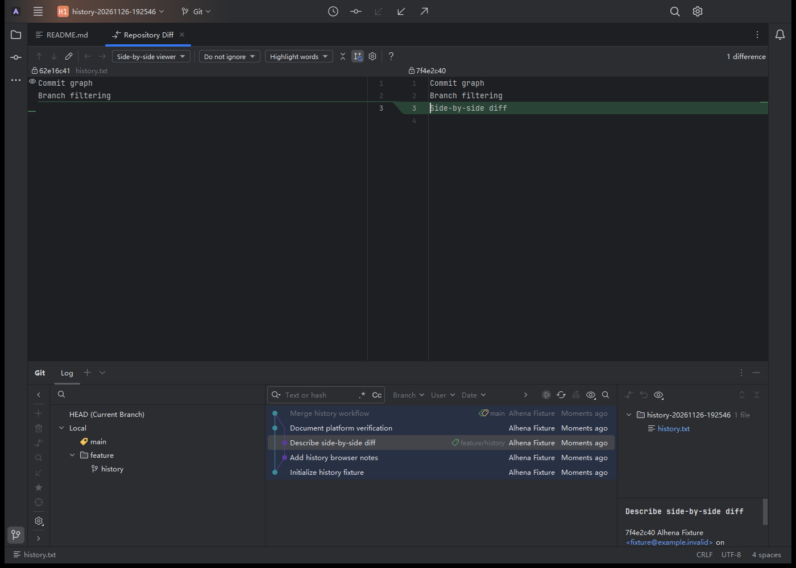

# Alhena

基于 IntelliJ Platform 的独立 Git 客户端。当前采用 **保留平台、裁剪产品** 路线，复用原版 Git4Idea、Git Log、Diff 与 Merge 能力。

当前计划 A–E 已完成：固定源码、独立 Windows 产品构建、Git Log / Diff 启动验证、暂存/提交/分支/冲突/同步工作流，以及首轮产品界面和模块裁剪、同机重复测量均已完成。交付为 Windows x64 便携 ZIP，保留平台基础设施和原版 Git 实现。此前的 WPF 实验保存在 `experiments/wpf-history/`，不再作为主线开发。



验收范围与证据见 [执行结果](docs/platform-product-plan.md)，对应源码见 [固定版本源码地图](docs/source-map.md)。SSH/HTTP 认证、超大仓库及 Rebase/Stash 等扩展场景未做完整测试矩阵，源码保留不等于逐项验收。

2026-11-27 已修复 ZIP 欢迎页“打开仓库”无响应，以及 Windows PowerShell 5.1 脚本编码/构建诊断兼容问题。当前程序包为 `out/releases/alhena-252.28539-4d1f78ac.win.zip`；真实按钮、文件选择器、信任确认和脚本启动的验证见 [启动修复记录](docs/startup-fix.md)。

## 固定基线

- 官方仓库：`JetBrains/intellij-community`
- 标签：`idea/252.28539.166`（ApplicationInfo 版本 `2025.2.6.5`）
- 提交：`b0d717640ee577a15b73fa79194629ff2a1d3d72`
- 首个目标：Windows x64、本地单体运行、Git Log 与 Diff 原版联动。

这是验证基线，不代表选择了当前最新版本。此前针对 `master` 的能力调查不能直接作为该版本的文件路径和 API 清单。

## 准备与检查

离线与跨设备重建使用独立依赖包，提交范围、导出/恢复和校验方式见 [离线重建说明](docs/offline-rebuild.md)。Git 保存源码和离线包锁文件；`upstream/`、`.cache/`、`out/` 继续排除。

需要 PowerShell、Git、Python 3.9+、curl.exe。编译使用上游 JPS bootstrap 自动下载的 JBR 与编译工具；不依赖 PATH 中的 Java 8，也不修改全局 Git 配置。

```powershell
.\build.ps1 -Action Prepare
.\build.ps1 -Action Audit
python -m unittest discover -s tests -v
```

首次准备会下载上游源码；下载目录 `upstream/`、构建缓存 `.cache/` 和输出 `out/` 均不纳入本项目版本控制。工具会验证上游提交，复制 `product/` 覆盖文件，注册 `alhena.product` 模块。重复执行会保护已经手动修改的覆盖文件，不会重置上游工作区。

依赖检查结果：`out/reports/dependencies.md` 与 `dependencies.json`。它们只反映非 TEST 的 JPS 依赖可达性（包含 PROVIDED），不等于最终运行时或打包模块清单。

## 构建入口

```powershell
.\build.ps1 -Action Compile
.\build.ps1 -Action Package
```

`Compile` 编译产品、Git、Log、Diff 入口及其依赖。`Package` 根据上游实际平台/插件布局计算生产模块集合，编译后复用这些输出进入 Windows ZIP 构建，避免发行入口默认请求编译整个项目。发行模块范围比静态小闭包更广。

构建输出：`upstream/intellij-community/out/alhena/artifacts/alhena-252.28539.SNAPSHOT.win.zip`，当前 250,135,869 字节（约 238.55 MiB）。随包携带官方无 JCEF 的 JBR 21.0.9。运行时下载通过锁文件中的大小和 SHA-256 校验。

修复版另存于 `out/releases/alhena-252.28539-4d1f78ac.win.zip`；SHA-256 为 `4d1f78ace6e4f69e2d53b1f92c23eff32b3cc6fca6503e499d69806e74e8d88e`。`c2bc63bb` 是修复前的历史验收基线。重新构建包含新的时间戳，哈希会变化，应重新执行验收。

构建会下载较多依赖；JBR bootstrap 的临时下载目录限制在项目 `.cache/bootstrap/` 下。上游工具也可能使用用户级 Maven/构建缓存。

## 启动与 GUI 验收

```powershell
# 打开 Git 欢迎页。
.\run.ps1

# 解压最新 ZIP，以独立配置打开仓库；正常运行保留项目信任询问。
.\run.ps1 -Repository 'D:\path\to\repository'

# 也可明确指定下载的程序包；无需先编译。
.\run.ps1 -Archive 'D:\Downloads\alhena-252.28539-4d1f78ac.win.zip' -Repository 'D:\path\to\repository'

# 新建专用测试仓库，验证提交图、分支、提交选择和双栏 Diff，然后关闭测试进程。
.\tools\smoke.ps1
.\tools\workflow-smoke.ps1
.\tools\product-smoke.ps1
.\tools\welcome-smoke.ps1
.\tools\welcome-smoke.ps1 -CommandLine
```

启动脚本使用项目 `out/sandbox/` 内的配置、缓存、插件和日志目录；GUI 验收使用单独的 `out/smoke/`。预建配置目录避免首次启动导入其他 IDE 的配置。`-Smoke` 的自动信任仅允许 `out/fixtures/` 下的测试仓库。

GUI 验收通过 JDK Attach 对自建测试进程执行原版动作和 Swing 控件，截图仅绘制该应用窗口。探针不打进发行包。三组验收分别覆盖 Git Log / Diff、完整基本工作流、原生首次启动与产品边界，完成后关闭自有测试进程。工作流测试只向专用本地裸仓库推送。

当前工作区候选包为 `out/releases/alhena-0.1.0-dev-252.28539-1e152f7e.win.zip`：原版 Git Log 位于中央，History 复用已有标签，提供 Git 设置直达入口；取消暂存、丢弃和 Stash 保存恢复已实测。中文已有项目、正常退出恢复、双栏 Diff 和完整冲突流程均完成同包回归。详情、证据和未解决观察项见 [最新工作区记录](docs/startup-fix.md#中央-git-工作区候选包)。当前包已完成真实 HTTPS/SSH 克隆、提交推送、Fetch/Update 及认证取消/拒绝和代理失败回归，临时测试密钥已撤销，见 [远程矩阵](docs/evidence/version-remote/result.json)。最终发布仍需源码、Tag 和 Release 关联。运行 `tools/clean-generated.ps1` 预览可清理的旧验收索引，加 `-Apply` 执行；源码、Git 仓库、发行包和编译依赖缓存保留。

初始基线的 66 项核对见 [历史交付审计](docs/evidence/delivery.json)，该轮只检查欢迎页按钮存在性。修复版增加真实按钮点击、原生文件选择器、实际打开仓库及 PowerShell 5.1 启动验收，见 [启动修复记录](docs/startup-fix.md)。截图和精简结果纳入 `docs/`；运行日志、缓存及专用仓库位于忽略的 `out/` 下，可清理后重新生成。

## 裁剪与测量结果

产品默认提供 Git 历史、原版暂存与同步工具栏、打开/克隆仓库欢迎页；移除 Run/Build/Code/Refactor 等主入口，关闭 IDEA 更新检查、插件推荐和使用统计。首次布局等待真实 Log 标签页就绪，后续保留用户窗口布局。

实际 ZIP 移除了云服务、运行仪表盘与 Services 视图共 6 个模块 JAR，压缩包减少 321,230 字节。编辑器、VFS、项目模型、部分 PSI/索引及共享执行 API 仍然保留。

同机三个场景各重复 3 次，正常保存并退出后再测缓存启动。任务结束后的工作集中位数下降约 18–24 MiB；启动时间范围重叠，不能据此宣称显著提速。完整中位数、范围、方法和原始记录见 [性能报告](docs/performance.md)。比较基线已经是早期 Alhena 平台外壳，不是完整版 IDEA。

## 结构

| 路径 | 内容 |
| --- | --- |
| `upstream.lock.json` | 上游版本、源码路径和构建入口 |
| `product/build/` | 独立产品属性与 JPS 构建目标 |
| `product/platform-build/` | 接入上游构建模块的发行布局桥接，不修改 Git4Idea |
| `product/resources/` | Alhena 应用信息、核心描述符与品牌资源 |
| `product/src/` | 产品默认设置、Git 工具栏、首次布局与欢迎页 |
| `tools/workspace.py` | 版本校验、覆盖文件应用、依赖报告 |
| `patches/upstream.json` | 固定上游兼容补丁、基线 SHA-256 与修改理由 |
| `run.ps1` / `tools/smoke.ps1` | 独立启动与真实 GUI 验收 |
| `tools/workflow-smoke.ps1` / `product-smoke.ps1` | 原版 Git 工作流与产品边界验收 |
| `tools/measure.ps1` / `verify-delivery.py` | 重复测量与最终产物、源码、验收证据核对 |
| `upstream/intellij-community/` | 本地官方源码工作树，不纳入本仓库 |
| `experiments/wpf-history/` | 已停止扩展的历史实验 |

产品边界和验收步骤见 [平台裁剪计划](docs/platform-product-plan.md)。


本地完整桌面门槛：`python tools/desktop-gate.py --archive <指定 ZIP>`，顺序执行八组 GUI/脚本回归并检查同包及源码摘要，结果见 [当前桌面记录](docs/evidence/version-desktop/result.json)。平台版本和升级方案见 [维护文档](docs/maintenance.md)。


Alhena 产品版本为 **0.1.0-dev EAP**，平台为 **2025.2.6.5 / Build 252.28539.SNAPSHOT**。ZIP 根目录 `alhena-version.json` 和原版 About 界面分别提供外部读取与运行时核对，产品版本源见 [维护说明](docs/maintenance.md)。当前包通过八组桌面及七组真实远程回归；远程清理曾发生 TLS 中断，重试撤销已确认，原始失败与恢复证据均保留。


P2 已发现真实仓库首启竞态及大工作树导入 IDE 工程配置的问题。`9b3ed7d1` 修复候选通过三个新目录启动和真实历史测量；24.9 万文件场景仍超过索引等待期限，项目配置隔离与最终同包回归尚在开发。最新状态见 [真实规模性能记录](docs/performance.md#真实历史测量与大工作树失败观察) 和 [候选审计](docs/evidence/current-candidate.json)。
