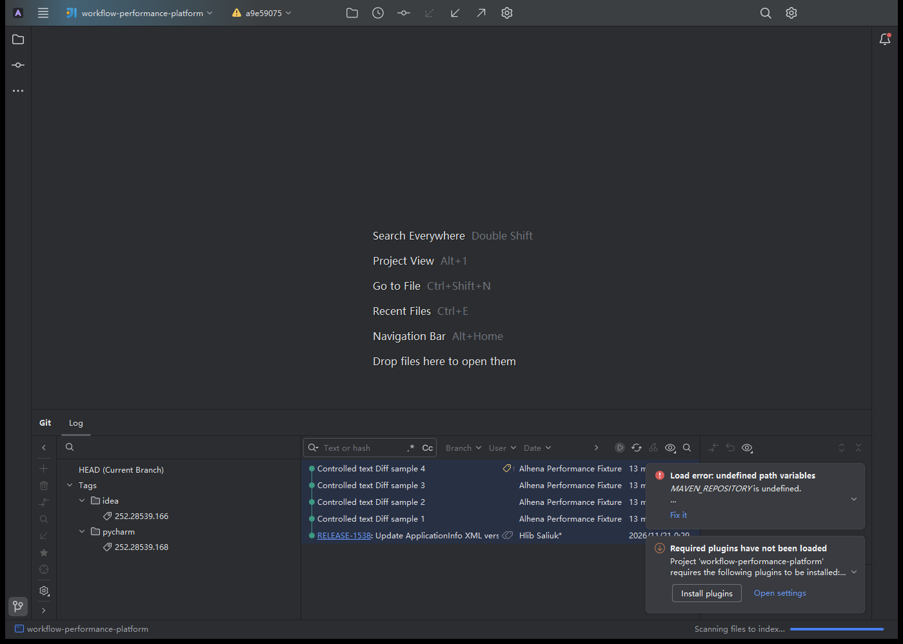

# Alhena 裁剪前后测量

同机、同一固定源码和运行时，各场景至少 3 次。下表为中位数 [最小–最大]；cached 场景排除预热样本。

数据为隐藏应用窗口的 Swing/EDT 探针观测，包含 Attach 与轮询开销；fresh 指应用配置/索引缓存，未清空操作系统文件缓存。每次通过平台退出流程保存设置并关闭 VFS；缓存启动不包含崩溃恢复样本。内存的末次采样在就绪后至少等待 5 秒、索引结束且公开进度任务连续两次为空后记录，不是峰值或强制 GC 后的存活集。

CPU：Intel(R) Core(TM) i7-14700K；Windows：10.0.19045；物理内存：63.7 GiB。

测试仓库：5 条提交、3 个文件，含分支合并。不能外推大型仓库性能。首次应用配置的仓库场景每次有新索引缓存，但测试仓库自身的 .idea 会在样本间保留。

| 场景 | 指标 | 裁剪前 | 裁剪后 |
| --- | --- | --- | --- |
| empty-fresh | 主窗口/EDT 就绪 (ms) | 1339.0 [1015.0–2010.0] | 1445.0 [1420.0–1954.0] |
| empty-fresh | 主窗口工作集 (MiB) | 449.9 [428.4–454.9] | 426.3 [425.3–430.1] |
| empty-fresh | 任务结束后工作集 (MiB) | 486.0 [479.8–496.1] | 462.5 [440.1–463.4] |
| empty-fresh | 任务结束后 heap used (MiB) | 102.9 [88.5–115.6] | 93.4 [90.0–95.4] |
| repository-fresh | 主窗口/EDT 就绪 (ms) | 1159.0 [1142.0–1766.0] | 1570.0 [1540.0–1601.0] |
| repository-fresh | Git Log 首屏 (ms) | 3147.0 [2515.0–3631.0] | 3112.0 [3013.0–3537.0] |
| repository-fresh | 主窗口工作集 (MiB) | 446.4 [421.6–470.7] | 482.4 [419.9–514.7] |
| repository-fresh | Git Log 首屏工作集 (MiB) | 684.0 [680.6–769.9] | 686.1 [679.0–739.6] |
| repository-fresh | Git Log 首屏 heap used (MiB) | 123.8 [122.2–133.2] | 109.6 [107.0–134.8] |
| repository-fresh | 任务结束后工作集 (MiB) | 721.6 [707.8–798.2] | 701.2 [685.3–760.0] |
| repository-fresh | 任务结束后 heap used (MiB) | 148.6 [110.1–159.2] | 126.4 [117.4–139.3] |
| repository-cached | 主窗口/EDT 就绪 (ms) | 1435.0 [1231.0–1663.0] | 1393.0 [910.0–1849.0] |
| repository-cached | Git Log 首屏 (ms) | 2910.0 [2213.0–3063.0] | 2765.0 [2334.0–3253.0] |
| repository-cached | 主窗口工作集 (MiB) | 461.9 [461.7–494.3] | 485.6 [461.0–498.9] |
| repository-cached | Git Log 首屏工作集 (MiB) | 664.5 [654.3–666.3] | 659.5 [659.4–705.8] |
| repository-cached | Git Log 首屏 heap used (MiB) | 109.0 [101.2–129.8] | 131.8 [128.7–138.9] |
| repository-cached | 任务结束后工作集 (MiB) | 689.6 [676.7–693.1] | 671.1 [667.7–717.7] |
| repository-cached | 任务结束后 heap used (MiB) | 109.9 [101.1–120.4] | 96.5 [95.1–170.9] |

原始记录：`D:\resources\code\github\loevc\Alhena\out\measurements\baseline-clean-20261126-193237\results.json`、`D:\resources\code\github\loevc\Alhena\out\measurements\trimmed-clean-20261126-193414\results.json`。


## 中央 Git 工作区测量试跑（非正式基准）

2026-11-28 对 `0ab35f94` ZIP 运行扩展测量脚本，保留 fresh/cached 三次样本和 cached 预热。脚本新增索引就绪时刻，以及选择提交后原版双栏 Diff 就绪耗时，并支持 `out/fixtures` 内的隔离真实仓库。详见 [试跑记录](evidence/central-small-performance-pilot.json)。

本次仍使用五条提交、三个文件的小仓库，且后台正在下载大型性能夹具，因此只能证明采集流程可工作，不能作为正式性能验收或提速依据。新增 Diff 步骤还改变了末次内存采样时的已打开界面范围，不能直接和本文前面的历史裁剪表比较。真实规模样本须待下载结束、后台任务安静后重新测量。

```powershell
.\tools\measure.ps1 -Archive out/releases/alhena-252.28539-0ab35f94.win.zip -Label git-scale -Runs 3 -Repository out/fixtures/<已准备好的仓库>
```

`indexSettledMs` 表示从启动到观测到项目非 dumb 状态的时刻，包含 Log 等待及探针开销，不是纯索引 CPU 耗时。`diffReadyMs` 包含提交选择、变更加载、Diff 展示和 Attach/轮询开销。正式报告必须记录仓库精确 HEAD、提交/跟踪文件数量、场景及版本哈希。


## 真实历史测量与大工作树失败观察

修复候选 `9b3ed7d1` 在 ripgrep 完整单分支历史上完成三次 fresh、一次 cached 预热和三次 cached 样本。仓库为 2,381 条提交、231 个跟踪文件，HEAD 为 `3e85c6c148fdce38a99ceeb9d2780dc7b03b4a4f`；实际测量使用新的独立克隆，未继承 `.idea`。此前 `1e152f7e` 的首轮真实仓库试跑触发中央 Log 创建空指针，判定无效；另一次旧包重跑通过，说明问题与时序有关，不能宣称旧包必现。

| 场景 | 窗口就绪中位数 | 首个可用 Log | 非 dumb 状态观察时刻 | 选择提交至双栏 Diff | 末次工作集中位数 |
| --- | --- | --- | --- | --- | --- |
| repository-fresh | 1.382 s | 2.865 s | 3.800 s | 1.058 s | 821.7 MiB |
| repository-cached | 1.651 s | 3.169 s | 3.355 s | 0.944 s | 768.5 MiB |

[完整中位数、范围及限制](evidence/ripgrep-performance-acceptance.json)。这些耗时包含 Attach/轮询开销；Log 就绪是首个可操作图，不代表已逐页加载所有提交。fresh 仅指应用配置/缓存，操作系统缓存和后续样本的仓库 IDE 状态保留。无效旧样本不能作为提速比较基线。

在固定 IntelliJ 上游的完整工作树中，249,210 个真实文件加 1 个受控文本 Diff 文件，共 249,211 个跟踪文件。原始历史是浅克隆的一条提交，另加四条隔离样本提交，因此该场景验证工作树规模，不验证深历史。首次试跑在 JVM 约 6.5 秒时已有底部 Git 图，但等待退出索引状态超过 180 秒，测量失败，未产生有效样本。

[大工作树观察](evidence/large-workspace-import-observation.json) 和截图显示原版 IDEA 工程被完整导入，出现缺少插件和 MAVEN_REPOSITORY 路径提示；中央区域仍为空，底部 Git Log 可用。当前等待 smart mode 才打开中央 Log 的策略也延迟了主工作区。不能据此宣称 P2 性能已通过。

下一步优先隔离 Alhena 工程存储和目录模块配置，保留真实仓库路径、Git 映射及仓库原有 IDE 文件，再重测。源码检查已找到平台 `ProjectStorePathManager` 应用服务入口；`ProjectStoreImpl.projectBasePath` 仍取打开的根路径。还必须替换默认目录配置器硬编码写入仓库 `.idea/*.iml` 的行为，仅修改存储路径并不足够。后续再根据实际指标决定索引范围，避免为了通过测量而直接过滤 Git 所需的数据。



## 工程隔离与文件类型扫描进展（尚未验收）

`bd2f264d` 已通过工程隔离回归：使用 Alhena 配置目录中的 `repositories/<路径哈希>/.idea`，只创建一个 EMPTY_MODULE，保留真实工作树为内容根。仓库原有 3,057 个 `.idea`/`.iml` 文件的路径与内容哈希均未变化；原版 Stage/Unstage 操作仍写入真实 Git 索引，重启恢复中央 Log。见 [隔离验收](evidence/isolated-workspace-acceptance.json)。

仅隔离配置后，大工作树扫描在 600 秒窗口内仍未结束。诊断线程栈显示未知文件类型在 `FileTypeDetectionService.getFirstBytes` 经 `DiskQueryRelay` 读取文件头。Java/Kotlin 文件合计 158,220 个，占该工作树约 63%。新增的文件类型覆盖器仅对指定源码扩展名且文件名类型为 UNKNOWN 的文件返回纯文本；保留已有语言、用户关联及二进制类型，不扫描内容。

候选 `ace0523d` 的首个 fresh 样本中央 Log 在 5.417 秒就绪，扫描稳定观察时刻为 177.053 秒，随后双栏 Diff 1.140 秒，正常退出。第二次 fresh 启动仍触发原版编辑器打开路径的空指针，**整轮测量判定未通过**。这一个样本只用于诊断，不能作为正式中位数或稳定性结论。见 [原始样本与限制](evidence/source-filetype-performance-observation.json)。后续修复编辑器异步加载路径后，需要重新完成 fresh/cached 各三次有效样本及同包功能回归。

## 异步编辑器修复后的同包规模验收

候选 `85f525e1`（完整哈希见证据）在两组数据上均完成 fresh 三次、cached 预热一次及 cached 三次；所有样本正常退出且无 SEVERE/ERROR 或 VFS 非正常恢复。下表为中位数 [最小–最大]。

| 仓库/配置 | 首个可见 Log（未区分界面）(s) | 扫描稳定观察时刻 (s) | 双栏 Diff (s) | 末次工作集 (MiB) |
| --- | --- | --- | --- | --- |
| 249211 文件 / fresh | 3.722 [3.323–4.486] | 29.253 [25.786–33.918] | 1.132 [0.878–1.186] | 2047.109 [2013.105–2059.055] |
| 249211 文件 / cached | 2.945 [2.629–2.979] | 7.606 [7.275–8.672] | 0.903 [0.883–0.950] | 806.738 [802.301–820.332] |
| 2381 条真实历史 / fresh | 4.591 [4.434–6.798] | 5.565 [5.405–7.673] | 1.104 [0.919–1.107] | 832.367 [809.898–837.512] |
| 2381 条真实历史 / cached | 3.080 [2.893–3.373] | 3.960 [3.818–4.280] | 0.960 [0.952–0.967] | 750.766 [727.906–792.348] |

完整数据及方法限制见 [大工作树验收](evidence/large-workspace-performance-acceptance.json) 与 [真实历史验收](evidence/current-history-performance-acceptance.json)。两者使用同一 ZIP，但检验不同维度；不能把它们合并宣称已测过同时具备几十万文件和数万提交的大仓库。

扫描稳定要求连续观测扫描器未运行、无待扫描任务、非 dumb、无运行进度且扫描器活动计数一致。Diff 在扫描结束后测量，不能据此声称已覆盖索引中的 Diff 操作。首次应用配置仍复用操作系统文件缓存；前期 600 秒超时和 177 秒诊断样本不构成同条件正式基线，因此不报告提速倍数。

本轮按诊断收益保留工程存储隔离、单一目录模块和未知源码纯文本回退。中央 Log 无需等代码索引，仓库文件和 Git 内容根保留。新配置的大工作树末次工作集仍约 2 GiB，缓存启动约 807 MiB；这属于平台保留方案的实际成本。暂不继续盲目排除平台模块或 Git 所需数据。后续若继续降低内存，应独立分析索引及 VFS 的保留集，并重新执行同包功能回归。

测量规则复核发现旧探针会匹配任意可见提交图；部分启动截图显示底部 Log 已有提交而中央仍在加载。上述旧 Log 耗时只能解释为首个可见提交图，不能解释为中央编辑器就绪。新探针仅统计选中中央编辑器内部的可见图，并使用扫描器 start/stop 事件计数；最终候选将按此重新测量。见 [测量纠正记录](evidence/central-measurement-observation.json)。

## 29f137bb 基线：中央编辑器专用测量

`29f137bb` ZIP 使用修正后的探针，在两个数据集上分别完成三次 fresh、一次 cached 预热、三次 cached。所有七次启动（含预热）的中央编辑器内部均有可见提交图，最终扫描/排队扫描/dumb/进度均为空，关闭日志无严重错误、扫描中断或 VFS 崩溃恢复。下表排除预热，为中位数 [最小–最大]。

| 数据集 / 配置 | 中央提交图 (s) | 扫描稳定观察时刻 (s) | 双栏 Diff (s) | 末次工作集 (MiB) |
| --- | --- | --- | --- | --- |
| 249211 文件 / fresh | 3.830 [3.355–6.893] | 33.792 [31.185–38.621] | 1.157 [1.125–1.212] | 2001.742 [1286.633–2026.980] |
| 249211 文件 / cached | 3.119 [2.886–3.261] | 7.448 [7.182–7.547] | 0.887 [0.876–0.985] | 824.977 [794.047–837.973] |
| 2381 条真实历史 / fresh | 4.002 [3.819–5.659] | 4.946 [4.761–6.584] | 1.132 [1.096–1.248] | 798.914 [787.746–836.840] |
| 2381 条真实历史 / cached | 2.980 [2.229–3.591] | 3.875 [3.112–4.559] | 0.975 [0.966–0.978] | 780.230 [715.820–828.531] |

[大工作树原始摘要](evidence/current-central-large-performance.json)；[完整单分支历史原始摘要](evidence/current-central-history-performance.json)。两者检验不同规模维度，不能宣称测试了同时具有几十万文件和深历史的同一个仓库。fresh 指新应用配置，操作系统缓存未清空；所有时间包含 Attach/轮询开销。Diff 在扫描稳定后测量。内存是末次采样，非峰值或强制 GC 后保留集；新配置扫描后的样本波动较大，因此保留范围，不报告内存优化倍数。

工程隔离与未知源码文件类型回退保留；未继续排除 Git 所需数据或盲目裁减平台模块。该 ZIP 已完成同包八组桌面与七组真实远程回归，见 [桌面门槛](evidence/current-desktop/result.json) 和 [远程矩阵](evidence/current-remote/result.json)。物理断网恢复及索引过程中的 Diff 操作不在本轮验证范围。

## 当前候选：中央编辑器专用测量

缓存读占用修复后的 `2a71563a` ZIP，在两个数据集上各完成 fresh 三次、cached 预热一次和 cached 三次。所有七次启动（含预热）均按选中中央编辑器内部图判定就绪，最终无扫描、排队扫描、dumb 或运行进度，正常退出且无严重日志、扫描中断或 VFS 崩溃恢复。下表为排除预热的中位数 [最小–最大]。

| 数据集 / 配置 | 中央提交图 (s) | 扫描稳定观察时刻 (s) | 双栏 Diff (s) | 末次工作集 (MiB) |
| --- | --- | --- | --- | --- |
| 249211 文件 / fresh | 3.687 [3.585–4.045] | 25.075 [24.449–27.147] | 0.949 [0.922–1.197] | 2076.125 [1938.090–2120.555] |
| 249211 文件 / cached | 2.741 [2.517–3.418] | 7.142 [6.835–7.745] | 0.934 [0.921–0.996] | 811.023 [806.016–826.477] |
| 2381 条真实历史 / fresh | 3.832 [3.699–3.846] | 4.937 [4.877–5.463] | 1.245 [1.162–1.250] | 923.949 [835.770–927.004] |
| 2381 条真实历史 / cached | 3.260 [2.960–3.660] | 4.662 [3.883–4.866] | 0.976 [0.972–1.001] | 758.145 [739.004–760.793] |

[大工作树原始摘要](evidence/cache-contention-large-performance.json)；[真实单分支历史原始摘要](evidence/cache-contention-history-performance.json)。方法限制同上：新应用配置并非冷 OS 缓存，两个仓库分测规模维度，时间含 Attach/轮询，Diff 在扫描稳定后测量，内存为末次而非峰值或强制 GC 后保留集。未报告跨旧测量规则的提速倍数。

该同包还通过 [八组桌面](evidence/cache-contention-desktop/result.json)、[七组真实远程及清理恢复](evidence/cache-contention-remote/result-reconciled.json)、[原版缓存专项](evidence/cache-contention-acceptance.json) 与 [HTTPS 中途断流/恢复](evidence/https-disconnect-recovery-acceptance.json)。缓存重试仅处理短暂读占用，持续拒绝及取消仍可见；不通过吞掉错误来获得绿色测量。
