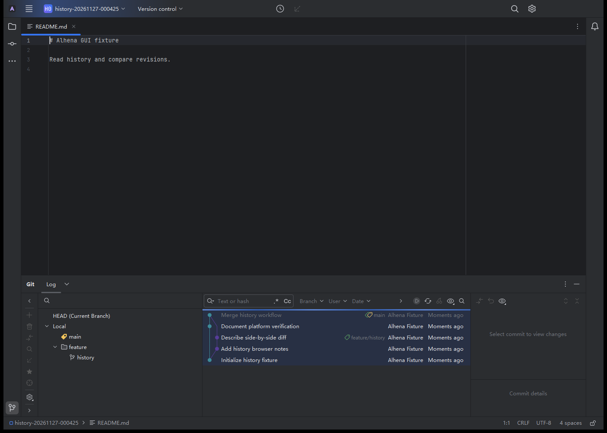
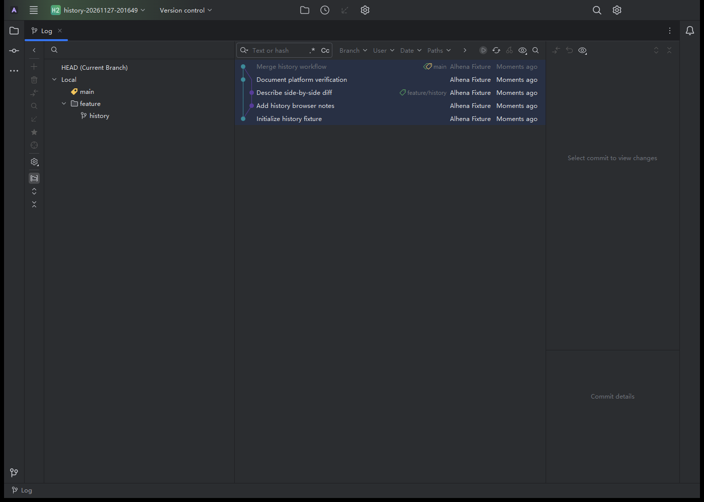
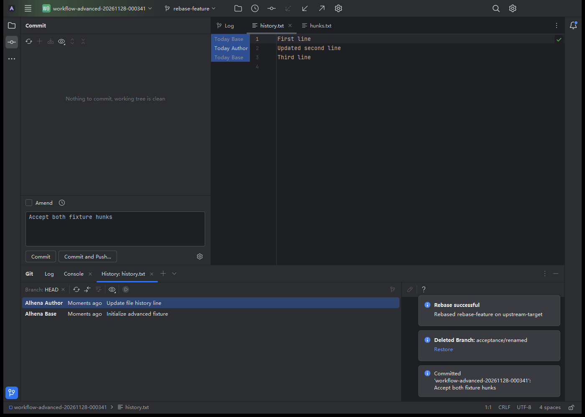
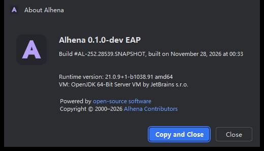

# 2026-11-27 启动修复

## 当前开发候选（2026-11-28，2a71563a）

当前包 `out/releases/alhena-0.1.0-dev-252.28539-2a71563a.win.zip`，SHA-256 `2a71563a782d2c7ef6e9d00e9b7c1cade03a316ff416184616c6d1558f278bdc`。产品为 0.1.0-dev EAP，Windows x64；正式发布仍等待主仓库源码提交、Tag、附件与校验和关联。[完整审计](evidence/current-candidate.json)。

在原版缓存接口中复现了历史同栈的 Windows 读占用失败：普通读取句柄/内存映射会阻止原子替换。新补丁只对 Windows AccessDenied 做有上限的20次尝试，保留原回退、取消/中断及临时清理；持续拒绝仍传播，旧内容不变。旧29包在20ms占用负对照失败，新包专项三轮通过。原始持有进程未留证，不能归因于具体软件。[复现](evidence/cache-rename-reproduction.json)、[专项](evidence/cache-contention-acceptance.json)。

同一 ZIP 完成八组桌面、七组真实远程、五次独立启动、大工作树隔离及两类规模各三次 fresh/cached 和一次预热；全部测试后原有3057个IDE文件仍未变。额外真实HTTPS补测在传输约77KiB时切断连接，原版Fetch显示失败，引用/索引/工作树不变；恢复后原版Fetch/Update成功，512KiB文件哈希及Git对象连通性检查通过。仅使用专用仓库本地代理，未修改主机网络。[补测](evidence/https-disconnect-recovery-acceptance.json)。

远程用例均通过，撤销临时密钥时遇到网络错误；重试撤销已确认，私钥删除，原始矩阵失败记录与清理恢复报告分别保留。该记录没有被覆盖为无失败。[原矩阵](evidence/cache-contention-remote/result.json)、[恢复确认](evidence/cache-contention-remote/result-reconciled.json)。

精确当前源码测试快照 `115279fc55ef7c7ea538ea43714c993a7e73a35c` 的托管检查和完整Windows打包成功；与桌面验收输入一致。CI附件是不同哈希的ZIP，未当作本地已做桌面回归的同一个文件；此快照位于授权测试仓库，不是正式Alhena发布提交。[CI证明](evidence/cache-contention-windows-ci-package-acceptance.json)、[源码输入](evidence/cache-contention-maintenance-acceptance.json)。


## 历史开发基线（2026-11-28，29f137bb）

当前便携包为 `out/releases/alhena-0.1.0-dev-252.28539-29f137bb.win.zip`，SHA-256 `29f137bb7bc42ed16e1f2cfcf505de9210e4a2097041336115d3764a08b9df22`。本节替代下文历史候选的“当前”称呼；旧记录保留用于追溯失败及修复过程。正式发布状态仍为 false，详见 [当前审计](evidence/current-candidate.json)。

本轮针对真实规模试跑修复了三条独立路径：

1. 原版 Log 编辑器可能先返回加载面板。编辑器动作改走不要求立即返回 MainVcsLogUi 的平台入口，标签登记、监听及原同步 API 保留，避免过早解引用。
2. 项目关闭先停止 ChangeListManager 更新队列、释放等待回调，再取消刷新指示器，消除取消刷新恢复回调与服务稍后销毁之间的窗口期。原有不变量检查保留。
3. Alhena 启动统一取得原版懒加载 NOOP 遥测管理器，避免后台服务抢先初始化后异步 SDK 安装触发单次初始化断言。其他产品路径保留，运行时明确断言 NOOP 类型和无 Span 导出器。

工程存储与模块文件外置到 Alhena 配置目录，保留真实仓库根与 Git 索引；测试中原有 3,057 个 IDE 配置文件的名称和字节未变。未知源码扩展名提供纯文本类型回退，已注册语言和显式二进制关联保留，避免大量不必要的文件头读取。实现入口及七个受保护补丁见 [源码地图](source-map.md) 与 [维护文档](maintenance.md)。

同一个 ZIP 已完成 [八组桌面回归](evidence/current-desktop/result.json)、[七组真实 HTTPS/SSH 回归](evidence/current-remote/result.json)、[五次独立启动](evidence/current-startup-acceptance.json) 和 [大工作树隔离](evidence/current-isolated-workspace-acceptance.json)。临时仓库级 SSH 密钥已撤销，本地私钥删除。代理失败测试不能等同物理断网恢复。

249,211 文件工作树和含 2,381 条提交的完整单分支历史分别完成 fresh/cached 各三次，以及每组一次预热。复核截图后修正测量规则，最终只统计选中中央编辑器内的提交图，并使用扫描器开始/结束事件计数；旧“任意可见提交图”耗时不当作中央就绪时间。完整范围及限制见 [性能报告](performance.md#当前候选中央编辑器专用测量)。

[当前源码 Windows 检查](evidence/current-windows-ci-checks.json) 与 [托管 Windows 打包](evidence/current-windows-ci-package-acceptance.json) 均已成功。打包对应 `3ecfa58` 测试快照，之后仅测量工具及文档/计划记录不同；当前 `b30fe4e` 检查快照与打包快照的产品、补丁及构建输入一致，证明见 [输入审计](evidence/current-maintenance-acceptance.json)。CI ZIP 与本地验收 ZIP 哈希不同，未把 CI 附件当作已做桌面验收的同一个文件。两者也都不是主仓库正式发布提交。

历史 Windows 缓存重命名 AccessDeniedException 的根因仍未确定，未以成功重跑代替修复证明。主仓库源码提交、Tag、Release 附件与哈希的正式关联仍待完成。


用户报告旧 ZIP 欢迎页“打开仓库”无响应，且 Windows PowerShell 5.1 执行 `run.ps1` 出现乱码与 ParserError。原验收使用命令行参数打开仓库，欢迎页仅确认按钮文字存在，没有覆盖实际点击，这是本次补齐的验证缺口。

## 原因与修复

1. `OpenFileAction.OnWelcomeScreen.update` 仅在 `ActionPlaces.WELCOME_SCREEN` 下启用。Alhena 按钮原传入 `AlhenaWelcome`，动作更新阶段直接禁用了 Open 操作。按钮现使用平台标准场景标识，继续由原版动作选择和打开目录。
2. 实际点击还触发产品缺失 `ProductivityFeaturesRegistry.xml` 的 SEVERE 日志。新增 Alhena 产品资源 `<features/>`，声明没有额外 IDE 使用提示；公共功能仍从平台的 `PlatformProductivityFeatures.xml` 加载。
3. Windows PowerShell 5.1 将无 BOM 的 UTF-8 脚本按系统 ANSI 编码解释，中文字符串被误解码，甚至产生意外引号。现有含中文的 PS1 文件保存为 UTF-8 BOM，Git 保留 BOM 和 LF；新增测试使用实际 Windows PowerShell 5.1 与已安装 PowerShell 7 解析源文件。
4. PowerShell 5.1 的 `2>&1` 把普通 Java stderr 转为 ErrorRecord，原 `ErrorActionPreference=Stop` 会提前终止构建。构建入口现在将诊断显式写入 UTF-8 日志，并以原生退出码判断成功；日志 I/O 错误仍终止执行。
5. `run.ps1` 优先使用当前构建包，没有上游产物时回退到 `out/releases`；也可用 `-Archive` 指定工作区外的下载 ZIP。

## 当前程序包

最新工作区候选包 `out/releases/alhena-252.28539-0ab35f94.win.zip`，250,138,621 字节，SHA-256：

```text
0ab35f948c7a5a27466127ebf6c50e5cb8121857f2a10fd9ac18262eefbe4c86
```

使用时重新解压此包并运行 `bin/alhena64.exe`，在欢迎页选择仓库目录，按需确认信任。旧 ZIP 不会自动获得本次修复。候选包尚未绑定新源码提交、Tag 或 GitHub Release，不能视为正式发布。

开发工作区也可运行：

```powershell
.\run.ps1 -Repository 'D:\resources\code\github\loevc\Alhena'
```

## 上一轮 4d1f78ac 实际验收（保留）

- Windows PowerShell 5.1 实际执行 `build.ps1 -Action Package`，退出码 0；构建日志 `out/logs/package-20261126-235859.log`。
- 直接启动 ZIP 中原生 EXE，不传仓库参数；点击真实 Open Repository 按钮，Windows 原生文件选择器出现；点击 Clone Repository，原版克隆对话框出现。为可重复选择目录，自动化随后切换到原版 IDE 文件选择器，选择专用 Git 仓库，点击 OK，确认真实信任对话框，最终看到五条提交的 Git Log。未设置自动信任。见 [欢迎页验收](evidence/welcome-open-acceptance.json)。
- Windows PowerShell `5.1.19041.6456` 实际调用 `run.ps1 -Repository`，确认信任后显示五条 Git 提交。见 [PowerShell 启动验收](evidence/powershell51-launch-acceptance.json)。
- 同一 ZIP 的分支树、提交选择、变更文件和原版双栏 Diff 通过回归，见 [Git/Diff 验收](evidence/startup-fix-git-diff-acceptance.json)。以上三个验收记录对应同一包哈希，日志均无 SEVERE/ERROR。
- 16 项 Python 测试通过，包括 PS1 编码与两个 PowerShell 解释器的实际解析检查。



此前 `docs/evidence/delivery.json`、性能报告和 `build-support/offline*.json` 均属于旧源码基线，不能作为修复后源码的新验收或离线锁。当前用户选择联网构建，因此本次没有重新生成大体积离线包。未来需要离线重建新版本时，应重新导出与该源码配套的包。

## 本轮原生选择与真实远程回归

已有 IDEA 项目中，Log 内容可能早于工具窗口可用。原逻辑在未真正显示时就记录布局完成，之后不再重试。现先检查可用性，监听窗口状态变化，并仅在实际可见后保存初始化标记；同时关闭平台启动时自动打开 README，避免抢占 Git 工作区。用户后续保存的布局仍沿用。

以下远程回归基线证据全部对应 `c9b5d639` 候选 ZIP，保留该包供回退：

[远程基线包核对记录](evidence/remote-baseline-candidate.json) 汇总该轮 13 份同包通过记录，核对 ZIP 中 8 个产品 class 与当时编译输出一致，并记录产品源码哈希、临时密钥撤销状态和正式发布前的未完成事项。

- [真实原生选择器与再次打开](evidence/native-existing-project-acceptance.json)：Windows PowerShell 5.1；中文、空格路径；已有 IDEA Java 模块配置；真实信任确认；打开及退出重开均显示五条提交。
- [PowerShell 5.1](evidence/powershell51-existing-project-acceptance.json) 与 [PowerShell 7](evidence/powershell7-existing-project-acceptance.json)：实际执行 `run.ps1 -Repository`，中文已有项目及再次打开均通过。
- [取消回归](evidence/welcome-cancel-acceptance.json)：原生目录选择器、原版克隆对话框可取消；之后仍可打开仓库。
- [HTTPS 克隆](evidence/remote-https-clone-acceptance.json)、[SSH 克隆](evidence/remote-ssh-clone-acceptance.json)、[HTTPS 同步](evidence/remote-https-sync-acceptance.json)、[SSH 同步](evidence/remote-ssh-sync-acceptance.json)：仅使用用户授权的 `loevc/Alhena-test`，原版界面暂存、提交、Push；独立 peer 推送后由原版 Fetch、Update 整合。HTTPS 克隆本身是公开读取，写入认证另外通过原版登录框的凭据助手验证。SSH 使用仓库专属临时部署密钥，结束后撤销并删除本地私钥。
- [认证拒绝](evidence/remote-auth-rejection-acceptance.json)、[取消认证](evidence/remote-auth-cancel-acceptance.json)、[网络不可用](evidence/remote-network-failure-acceptance.json)：拒绝 SSH 认证后欢迎页可用；取消 HTTPS 登录保留本地提交且远程未变，可重新推送；不可达进程专属代理触发连接失败，无残留克隆仓库。代理测试不等同于实际拔网线，没有修改系统网络或全局 Git 配置。
- [原版完整工作流](evidence/current-workflow-acceptance.json) 与 [提交图、分支树、双栏 Diff](evidence/current-git-diff-acceptance.json) 同包回归通过；19 项 Python 测试通过，包含两个 PowerShell 的语法检查及远程测试密钥清理保护。

一次 HTTPS 回归捕获了 `WorkspaceModelCacheImpl` 保存项目模型缓存时的 `AccessDeniedException`，该轮判失败。后续同包 HTTPS 完整复跑通过，SSH 及其他通过记录日志均无严重错误；这次偶发缓存写入异常尚未定位根因，保留为待观察问题，不能宣称已经修复。

复现原生中文已有项目检查：

```powershell
.\tools\welcome-smoke.ps1 -NativeSelection -FixtureSuffix ' 中文 repo' -ExistingProject -Reopen
.\tools\welcome-smoke.ps1 -CommandLine -FixtureSuffix ' 中文 repo' -ExistingProject -Reopen
```

远程验收使用 `tools/remote-fixture.py` 准备独立分支和临时密钥，`tools/welcome-smoke.ps1 -RemoteContext ... -Transport https|ssh` 通过原版克隆对话框操作，`tools/remote-sync-smoke.ps1` 验证原版提交和同步；最后必须执行 `remote-fixture.py cleanup --context ...`。上下文、私钥及所有运行产物仅存于被忽略的 `.cache/`、`out/`，不会进入发行包。

`tools/clean-generated.ps1` 默认仅预览，`-Apply` 清理旧隔离验收目录内明确列出的索引缓存；保留最近两轮、源码、所有 Git 仓库、编译依赖缓存、发行包、日志及截图，拒绝穿过重解析点，Alhena 运行时拒绝删除。本轮实际回收量见 [缓存清理记录](evidence/generated-cache-cleanup.json)。

本轮的完成范围与剩余产品工作记录于 `build-support/iteration-plan.json`。常用高级 Git 功能逐项验收、主要工作区调整、CI、规模性能测量、独立产品版本及正式发布关联仍需继续。

## 中央 Git 工作区候选包

`0ab35f94` 将原版 Git Log 放入中央编辑区。History 通过原版 `Vcs.Log.OpenAnotherTabInEditor` 动作打开，之后复用已有 `vcs-log` 标签。首次打开等待 Log 内容就绪，避免跨平台模块类加载器直接引用；正常退出后由上游标签恢复机制重新打开。分支栏保留上游新标签的折叠默认值，可点击 Branches 展开。

主工具栏增加原版打开入口和 Git 设置直达按钮；Git 设置通过 `vcs.Git` 配置 ID 定位原版页面。移除执行目标工具栏。没有重写提交图、Diff、Git 设置、暂存或 Stash 引擎。

- [工作区及基础 Git 验收](evidence/workspace-git-acceptance.json)：中央原版 Log、History 连续点击不重复、Git 设置直接进入 Git 可执行文件页、取消设置返回、暂存与中央历史并存、所选文件取消暂存且保留工作内容、丢弃仅影响所选文件、Stash 保存与原版 Saved Patches 浏览器 Apply 恢复、正常退出后中央标签恢复。
- [中央 Log / Diff](evidence/central-git-diff-acceptance.json)：通过原版 Branches 按钮展开分支栏，校验实际可见宽度；展开 main 与 feature/history，选择提交与文件并显示原版双栏 Diff。截图在 Swing 完成布局后绘制。
- [完整工作流回归](evidence/central-workflow-acceptance.json)：暂存、提交、空提交拒绝、分支往返、本地远程同步、三方冲突解决和双父合并提交。
- [中文已有项目回归](evidence/central-native-existing-project-acceptance.json)：Windows PowerShell 5.1、真实原生目录选择、中文空格路径、已有 IDEA 配置、真实信任确认及退出重开。

以上四组记录对应同一 `0ab35f94` ZIP，日志无 SEVERE/ERROR。19 项 Python 测试继续通过。[当前候选核对记录](evidence/current-candidate.json) 区分本包证据与旧远程基线；完整 HTTPS/SSH 矩阵尚未在本包重跑。主窗口仓库切换矩阵已在后续验收完成，见下节。

```powershell
.\tools\workspace-git-smoke.ps1
.\tools\smoke.ps1
.\tools\workflow-smoke.ps1
```



## 2026-11-28 高级 Git 验收

[高级 Git 通过记录](evidence/advanced-git-acceptance.json) 继续使用同一 `0ab35f94` ZIP，未改动产品或 Git4Idea 源码。专用仓库含两个相距 32 行的改动、分支及已知逐行作者历史：

- 点击原版行变更弹窗的 Stage，只将第一块写入真实索引；第二块仍在未暂存 Diff 中。点击原版 Unstage 清空索引，工作文件仍保留两块改动。
- 原版 New Branch、Rename Branch 对话框，以及原版分支上下文 Delete 动作，验证分支创建、重命名、删除和起点提交。
- 在原版中央 Log 选中提交，通过平台动作调度执行 Cherry-pick，验证新提交父节点、内容及源分支引用。
- 原版 Rebase 对话框选择上游，验证上游成为新父节点、功能提交重写、两个分支文件内容正确且工作区干净。
- 原版 Annotation Provider 核对三行各自的提交哈希，原版 Annotate 在编辑器显示 Base / Author / Base（上游默认缩写）；原版 File History 显示预期两条提交，并与原版文件历史 Provider 返回值一致。

测试通过原版控件和动作执行，后台查询安装平台进度上下文，动作由平台遵循 BGT 更新、EDT 执行约束。程序化选择行后只刷新专用测试进程的 UI 数据快照，没有向 Cherry-pick 注入提交选择或绕过线程检查。最终通过记录日志无 SEVERE/ERROR。强制分支删除、冲突型 Rebase/Cherry-pick 的继续与中止、逐行选择暂存等边界未纳入本次成功流程验收。

```powershell
.\tools\advanced-git-smoke.ps1
```



## Windows CI 配置

`.github/workflows/windows.yml` 在源码变更的 Push / Pull Request 上执行 Python 测试及实际 Windows PowerShell 5.1、PowerShell 7 语法检查。手动触发时可选择 `build_package`，再执行联网 Package、编译外部验收探针，保存源码提交、上游提交和 ZIP 哈希，并上传候选产物与构建诊断。该工作流尚未提交到 GitHub 执行，本地测试通过不能代替远程 CI 结果。

工作流固定官方 Actions 的完整提交哈希，对应 [checkout v7.0.1](https://github.com/actions/checkout/releases/tag/v7.0.1)、[setup-python v7.1.0](https://github.com/actions/setup-python/releases/tag/v7.1.0)、[upload-artifact v7.0.2](https://github.com/actions/upload-artifact/releases/tag/v7.0.2)。候选元数据明确记录 `desktopAcceptance=not_run_on_hosted_runner`、`releaseReady=false`。真实原生文件选择器和桌面 GUI 验收仍须在交互式 Windows 桌面独立执行，后续将汇总为同包门槛脚本。


## 2026-11-28 仓库切换与桌面门槛

[仓库切换记录](evidence/repository-switch-acceptance.json) 使用 `0ab35f94` ZIP，在主窗口点击真实 Open 工具栏按钮并操作 Windows 原生选择器。取消后保持当前仓库；重复选择同一目录只有一个项目；选择第二个中文空格路径的已有 IDEA 项目后显示六条提交；切回首仓库后恢复五条提交。[产品边界记录](evidence/central-product-acceptance.json) 验证中央 Log、Git 工具栏和无关 IDE 入口裁剪。

新增本地串行桌面门槛：

```powershell
python tools/desktop-gate.py --archive out/releases/alhena-252.28539-0ab35f94.win.zip
python tools/desktop-gate.py --verify out/desktop-gate/<本次目录>/result.json
```

需要交互式 Windows 桌面、Windows PowerShell 5.1、PowerShell 7 和本项目构建缓存中的 JDK。执行期间不要运行另一组 GUI 验收，也不要修改产品或测试源码。八组检查串行运行：原生仓库切换、5.1/7 命令行打开、产品边界、提交图与 Diff、基本 Git 工作流、工作区恢复、常用高级 Git。每组必须产生全新的通过记录且匹配指定 ZIP；汇总复制各组结果、保留控制台日志，并记录当前源码文件和证据 SHA-256。复核会拒绝缺失用例、不同 ZIP、被修改的证据或源码。

该门槛只表示本地桌面范围的验收。真实 HTTPS/SSH 远程矩阵、最终源码提交/Tag/Release 关联、性能与维护工作仍分别跟踪。源码摘要记录验收时的工作树，不代表 ZIP 已由某个已提交版本重新构建。完整探针日志和截图保留在各结果的原始 evidence 目录。


## 2026-11-28 中央工作区 ZIP 真实远程回归

[当前远程矩阵](evidence/central-remote/result.json) 对同一 `0ab35f94` ZIP 完成七组回归：HTTPS/SSH 原版 Clone、两种传输的原版 Stage/Commit/Push/Fetch/Update、HTTPS Push 认证取消后重开、SSH 认证拒绝、不可达进程代理失败后欢迎页可继续使用。真实写入均限定于用户授权的 `loevc/Alhena-test`，使用独立测试分支。测试结束已确认仓库级临时 deploy key 撤销、本地私钥删除；未修改全局身份、SSH 或网络设置。

```powershell
python tools/remote-fixture.py prepare --repository loevc/Alhena-test
# 使用 prepare 输出的 context；以下操作会写入该专用测试仓库。
python tools/remote-matrix.py --context .cache/remote-test/<本次目录>/context.json --archive out/releases/alhena-252.28539-0ab35f94.win.zip
```

远程矩阵串行运行并在 finally 中执行密钥清理。执行前须确认对该测试仓库的写权限和仓库级 deploy key 管理权限；本项目已获用户明确授权。若清理失败，汇总标记 failed 并保留需要处理的状态。此前一次矩阵在额外的远程 HEAD 读取阶段失败，清理成功；修正脚本后完整重跑通过。新 seed 分支不会改变已有仓库的默认分支，因此 Clone 检查远程实际公布的默认 HEAD、实际 origin 和实际检出的提交。

本轮网络失败仍是不可达进程专属代理，未覆盖实际物理断网及恢复。旧 `c9b5d639` 的记录保留为历史基线；最终源码/Tag/Release 关联、Windows 缓存写入观察和 P2 仍待处理。


[本轮完整桌面门槛](evidence/central-desktop/result.json) 已在远程脚本修正后重新执行，八组全部通过；ZIP、验收时源码与各组证据 SHA-256 复核通过。26 项 Python 测试通过。该结果仍不代表已发布：GitHub Actions 实际运行、源码/Tag/附件关联及 P2 继续跟踪。

平台维护方案与受保护补丁的回归映射见 [维护文档](maintenance.md)。独立产品版本的打包及界面展示仍待实现；文档方案不能替代运行验收。


## 2026-11-28 独立产品版本候选

当前候选 ZIP：`out/releases/alhena-0.1.0-dev-252.28539-1e152f7e.win.zip`，SHA-256 `1e152f7e69f4162a1f619364758c458ec82d748ac6c9e54abc04c68f21ac13d4`，250,138,990 字节。版本来源为应用描述符的 version/full；major/minor 继续保持平台兼容语义。原版 About 显示 `Alhena 0.1.0-dev EAP`、`AL-252.28539.SNAPSHOT`，根目录和 app.jar 内的版本元数据均与固定上游及 JBR 一致。ZIP 内九个产品类与本次编译输出逐字节相同。

- [八组桌面门槛](evidence/version-desktop/result.json)：全部通过，源码与 ZIP 摘要复核通过。
- [七组真实远程门槛](evidence/version-remote/result.json)：用例通过。首次撤销 deploy key 时 GitHub API TLS 中断导致整体 failed，独立重试后确认撤销和私钥删除；保留 [原始汇总](evidence/version-remote/first-attempt-result.json) 与清理恢复记录，并重新校验七组证据、源码和 ZIP 摘要。
- [版本与维护验收](evidence/version-maintenance-acceptance.json)：28 项测试、真实补丁原始 SHA 与应用内容核对、升级漂移拒绝及运行工作流通过。未来平台升级必须另行执行维护流程。
- [Windows CI 检查](evidence/windows-ci-checks.json)：在授权测试仓库的独立分支，以构建源码快照提交 `af82d88ad88b696245fbc2d63979695b6379422c` 运行成功。[检查任务](https://github.com/loevc/Alhena-test/actions/runs/46035948843) 包含真实两种 PowerShell 的脚本解析。单独触发的 [托管 Package](https://github.com/loevc/Alhena-test/actions/runs/46036064719) 仍在执行，不能提前声称干净环境构建已通过。

该测试快照提交属于 Alhena-test，不是 Alhena 源码仓库的正式提交；候选元数据继续明确 sourceChangesCommitted=false、releaseReady=false。真实规模性能样本、托管 Package 结果和正式源码/Tag/Release 关联仍需完成。此前 `0ab35f94` 工作区候选及其证据保留为历史基线。




## 真实仓库首启回归与待解决的大工作树导入

P2 测量发现 `1e152f7e` 在首开 ripgrep 时，中央 Log 创建路径触发 `VcsLogTabsManager.openAnotherLogTab` 空指针。该次测量已拒绝，见 [原始观察](evidence/startup-readiness-observation.json)。修复候选 `9b3ed7d1` 等待 VCS 初始化和 smart mode，使用原版 Log 数据上下文，并合并重入回调；[三个无 .idea 的全新仓库启动](evidence/startup-readiness-acceptance.json) 与 [真实历史三轮测量](evidence/ripgrep-performance-acceptance.json) 通过。

```powershell
.\tools\repository-startup-smoke.ps1 -Archive <指定 ZIP> -SourceRepository out/fixtures/<已有隔离仓库> -Runs 3
```

但 249,211 文件的大工作树仍被当作原有 IDEA 工程导入，索引等待超过 180 秒，中央工作区也被 smart-mode 门槛延迟。当前候选仍在开发，未完成最终同包门槛，不能作为发布就绪结论；[性能报告](performance.md#真实历史测量与大工作树失败观察) 记录了实际结果和下一步隔离项目配置的方案。


[托管 Windows Package](https://github.com/loevc/Alhena-test/actions/runs/46036064719) 后续已成功完成。[构建证据](evidence/windows-ci-package-acceptance.json) 包括实际步骤、附件及校验后的 [内部程序包元数据](evidence/windows-ci-package-metadata.json)：250,138,984 字节，SHA-256 `8b7811b8b285a151ad07d3c3976e61b965301806017380beabfc115df37a3049`。构建输入为测试快照 `af82d88`，不包含随后本地的启动修复。CI 产物明确 desktopAcceptance=not_run_on_hosted_runner、releaseReady=false。与本地 ZIP 构建时间不同，不宣称两个 ZIP 字节相同或可互换桌面验收。
